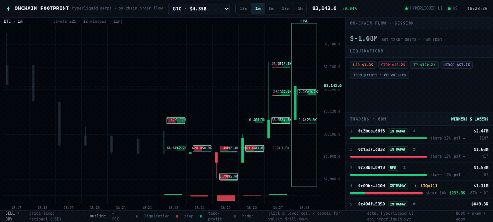
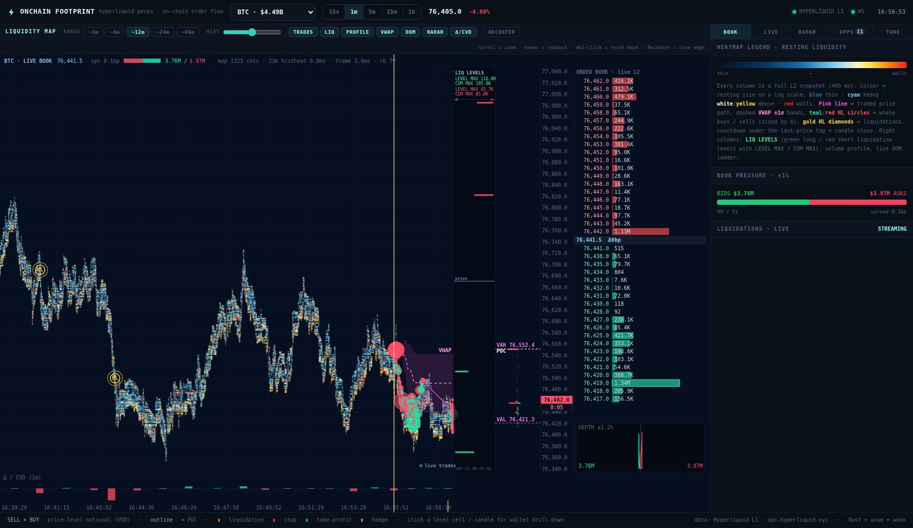

# ⚡ Onchain Footprint

**A new charting standard for Hyperliquid perps — built entirely in Rust, powered by all available on-chain data.**





Onchain Footprint is a realtime order-flow terminal that lets you **look inside every candle across all Hyperliquid perpetuals**. Every trade on Hyperliquid is fully on-chain and attributed to wallets, so the footprint shows *who* is buying and selling, *why* (intent), and *whether those traders are winners or losers*.

- **Bookmap terminal** — a full liquidity-map terminal (`BOOK` tab): live L2 **heatmap** of resting orders (reference ramp `navy → blue → cyan → white → yellow → orange → red` on a log size scale, one column per book snapshot), a **pink price path** with candle-close countdown, dashed **VWAP ±1σ bands**, **trade bubbles** (teal buys / red sells, whale prints venue-tagged `HL`), **gold liquidation diamonds**, a **LIQ LEVELS rail** (green long / red short liquidation levels with LEVEL MAX / CUM MAX), the live **DOM ladder** with depth bars, a cumulative **depth chart**, a **volume profile** with POC/VAH/VAL, a **Δ/CVD strip**, and the radar's magnet levels drawn straight onto the map.
- **Footprint chart** — per price level inside every candle: taker **SELL × BUY** notional (USD), heat-mapped, with the point-of-control outlined and a per-window delta strip.
- **Who is trading** — every print carries the **taker and maker wallet** (link straight to Hypurrscan). A 60-minute trader leaderboard ranks wallets by flow with per-wallet buy/sell split and market share.
- **Intent behind each trade** — fills are classified live as `AGGR` (aggressive open/increase), `LIQ` (liquidation), `DELEV` (deleveraging), `STOP` (realized-loss reduce), `TP` (realized-profit reduce), `HEDGE` (cross-market delta-neutral leg) or `REDUCE`.
- **Winners & losers** — wallets are enriched via on-chain `userFills`: realized PnL, win rate, account value, and a conviction tag (`++ + ± - --`).
- **Trading style** — behavioral + enriched classification: `MM` (resting/maker-dominated), `SCALPER`, `INTRADAY`, `DAY`, `SWING`, `POSITION`.
- **Level drill-down** — click any footprint cell (or candle) to open the wallets that traded that exact price bucket in that exact window: bought/sold, session and all-time PnL, win rate, open/increase/reduce/flip split, liquidation flag.
- **Liquidation radar** — armed **magnet levels** (estimated forced-flow pockets, long and short side), live cascade tracking with sweep slippage, and an overhang summary (armed long-liq flow below price vs short-liq flow above).
- **Opportunities** — a live scanner turns detected events into tradeable setups: `MAGNET` (armed level pulling price), `EXHAUST` (cascade finished — mean-reversion window), `SWEEP` (cascade printing now), `STOP-RUN` (stop cluster fuel above/below), `ABSORB` (one-sided delta with flat price), `WHALE` (large print from a winning wallet), `S/R` (swept level retest).
- **Live tuning** — every engine threshold (LIQ strictness, radar grid, cascade rules, opportunity gates) is editable at runtime from the TUNE tab and survives restarts.
- **Realtime** — trades, candles and liquidation events stream from Hyperliquid's L1 over WebSocket; the engine folds every print into the live candle as it prints.

## The UI

Five sidebar views:

| tab    | what it shows |
|--------|---------------|
| `BOOK` | bookmap terminal — live L2 heatmap of resting liquidity, trade bubbles, liquidation diamonds, DOM ladder, depth chart, volume profile (POC/VAH/VAL), Δ/CVD strip, radar magnet lines |
| `LIVE` | footprint chart, session flow stats, liquidation feed, on-chain tape, trader leaderboard |
| `RADAR`| magnet levels (state `ARMED / ENGAGED / SWEPT`, estimated forced flow, distance from price), cascade history (`last_cascade`), overhang pills |
| `OPPS` | live opportunities with kind, strength (0–100), direction bias, target price and TTL |
| `TUNE` | every engine parameter as a live slider — changes POST to the engine and apply immediately |

### The bookmap terminal (`BOOK` tab)

A bookmap-style liquidity terminal rendered on one canvas, styled after the
reference liquidity-map screenshots (blue/red resting orders, pink price
path, LIQ LEVELS rail):

- **Heatmap** — every column is a full L2 book snapshot. Colour encodes resting
  size on a log scale from the 15th→94th percentile of visible levels using
  the reference ramp `navy → blue → cyan → white → yellow → orange → red`
  (thin `blue` resting orders → walls `red`); the zero colour equals the pane
  background. The **HEAT** slider slides the colour window along the size
  axis (left = only the biggest walls, right = lighter liquidity lights up);
  double-click resets.
- **Price path** — the traded price traces a **pink** line across the heat
  (with a dark casing so it reads over bright walls); the axis carries the
  last-price tag plus an **m:ss candle-close countdown** beneath it.
- **Session VWAP** — dashed pink **VWAP ±1σ bands** computed as a running
  USD-weighted mean/variance over the visible prints (toolbar: `VWAP`).
- **Trade bubbles** — every print lands on the map: teal = market buy, red =
  market sell, radius by USD; whale prints carry the venue tag **`HL`**.
  `LIQ`/`DELEV` prints render as **gold diamonds** with a glow and an
  `HL <size>` label; standalone liquidation events draw gold `HL` rings.
- **LIQ LEVELS rail** — a right-hand panel in the reference style: estimated
  forced-flow per price row as **green long / red short bars** with
  `LEVEL MAX` / `CUM MAX` stats per side, a `price` tick and a `±8%` domain
  note. The panel maps its own wider price domain so the full liquidation
  landscape stays visible even when the chart is zoomed tight on the heat.
- **DOM ladder** — the live book: worst→best asks (red bars) above the
  spread row, best→worst bids (teal bars) below, sizes in USD, wall rows
  outlined.
- **Depth chart** — cumulative bid/ask curves ±1.2% around mid.
- **Volume profile** — buy/sell histogram of the visible window with
  **POC** and the 70% value area (**VAH/VAL**) on dark backing chips.
- **Δ/CVD strip** — per-minute taker delta bars with the cumulative-delta line.
- **Radar overlay** — armed/engaged magnet levels as dashed lines with
  estimated forced-flow labels.
- **Interaction** — scroll to zoom time, hover for a price/time/level-size
  readout, toolbar toggles for every panel, range presets ~3m…~45m, and
  **RECENTER** to jump back to the live edge (default zoom, auto price fit,
  neutral heat). A pulsing **`live trades`** chip marks the streaming print
  feed at the bottom-right of the heat.

Book data pipeline: the coin you watch is subscribed to Hyperliquid's
`l2Book` WS channel *and* polled over REST (~2 Hz) to densify the map (the
public WS pushes snapshots only every few seconds); snapshots are sampled
into a ~48-minute column ring per coin and streamed to the browser.

> Note: Hyperliquid's public book (WS and REST alike) is capped at **20
> levels per side** at the venue's own grouping — the map shows the real
> public book, nothing synthetic.

## Stack

Pure Rust, frontend and backend:

```
Hyperliquid L1 (api.hyperliquid.xyz: info REST + wss realtime)
        │
        ▼
┌────────────────────────────────────────────────────────┐
│ backend  (axum + tokio)                                │
│  · upstream WS connector (trades+candles, auto-rejoin,  │
│    universe-guarded subscriptions)                     │
│  · wallet registry: live position tracking, realized   │
│    PnL, hedge matching, intent engine                   │
│  · enrichment: userFills + clearinghouseState polling   │
│  · radar: magnet levels, cascades, overhang (persisted) │
│  · opportunity scanner (magnets, stops, whales, …)      │
│  · bookmap: L2 book sampler + l2Book poller (persisted   │
│    column history per watched coin)                     │
│  · live tuning store (persisted)                        │
│  · footprint / level-detail aggregation on demand       │
│  · browser WS fan-out + JSON REST                       │
└───────────────┬────────────────────────────────────────┘
                │  REST /api/* + WS /ws (JSON)
                ▼
┌────────────────────────────────────────────────────────┐
│ frontend (Rust → wasm32 via wasm-bindgen / web-sys)    │
│  · canvas footprint engine (candles + level cells,     │
│    POC, intent bars, delta strip, crosshair, LIVE tag)  │
│  · bookmap terminal (offscreen-canvas heatmap with     │
│    incremental column scroll, DOM ladder, depth,       │
│    profile, Δ/CVD, radar overlay, crosshair)           │
│  · realtime tape / liquidations / trader leaderboard    │
│  · radar / opportunities / tuning panels                 │
│  · level drill-down modal                               │
└────────────────────────────────────────────────────────┘
```

Workspace layout:

| crate      | what it is                                                       |
|------------|------------------------------------------------------------------|
| `shared`   | wasm-safe types + footprint bucketing math (used by both sides)  |
| `backend`  | axum server, Hyperliquid connector, intent + radar + opps engine |
| `frontend` | wasm-bindgen / web-sys terminal (canvas + DOM), built with trunk |

## Run it

Requires: Rust (stable) with the `wasm32-unknown-unknown` target and `wasm-bindgen-cli` (both invoked by `scripts/build-web.sh`).

```bash
# build the frontend (wasm -> frontend/dist)
./scripts/build-web.sh

# run the backend (serves the UI on http://localhost:3000)
cargo run --release -p backend
```

Then open <http://localhost:3000> — the terminal boots straight into the
`BOOK` liquidity map (it fills in as book snapshots accumulate; the map
auto-fits until the ~48-minute history saturates the zoom window). Use the
market dropdown to switch coins and the `15s / 1m / 5m / 15m / 1h` buttons to
change the footprint window on the `LIVE` tab. Click a level cell (or any
candle) for the wallet drill-down.

By default the engine tracks the **top 16 markets by 24h volume** (with a static 20-coin majors fallback while the universe loads). The engine state (radar levels, cascade history, tuning parameters) is persisted under `data/` every 15s and restored on restart, so **overhang signals survive restarts**.

[trunk]: https://trunkrs.dev

## How the intent engine works

Hyperliquid's realtime trade stream attributes each fill to its **taker and maker wallets**, and the info API exposes per-wallet `userFills` (with `closedPnl`, `startPosition`, and a `liquidation` marker) and `clearinghouseState`. Onchain Footprint combines three signals:

1. **Live position tracking** — every taker fill updates a per-wallet, per-coin position, yielding the fill's action (`open / increase / reduce / flip`) and realized PnL.
2. **Liquidation events** — `userEvents` for the largest tracked position holders flag force-closures directly; plus a **strict behavioral detector**: an aggressive near-full close of a real loss must also clear the `liq_conf_cap` confidence floor and sweep the book by at least `liq_min_sweep_slip_bps` (vs the 30s-ago reference price) before it is tagged `LIQ`, and the whole burst is retro-tagged.
3. **Hedge matching** — a fill that offsets a recent opposite-direction fill in a *different* coin with similar notional is tagged as a delta-neutral `HEDGE` leg.

Reductions that realized a loss are `STOP`s, reductions that realized a profit are `TP`s, everything else is plain `AGGR` or `REDUCE`.

## How the radar and opportunity engines work

- **Magnet levels** — as wallets open/increase leveraged positions, the engine estimates where forced flow (liquidations) would trigger, bucketed on a `radar_bucket_bps` grid. Each level carries an estimated notional (`est_usd`) that decays with a half-life (`radar_decay_min`) as positions adjust. Levels transition `ARMED → ENGAGED → SWEPT` as price trades through them; a crossed level that sees no forced flow within `radar_confirm_ms` re-arms at half strength.
- **Cascades** — chained forced-flow bursts are grouped into cascade records (`last_cascade`): direction, total forced USD, fill count, wallets, price range, deepest sweep slippage, and the magnet levels consumed on the way. They are persisted and replayed for the `EXHAUST` and `S/R` opportunity kinds.
- **Overhang** — the radar summarizes armed long-liq flow within 5% below price and short-liq flow within 5% above, plus the nearest armed level on each side. Heavy overhang on one side is the classic fuel for a magnet pull.
- **Opportunities** — the scanner runs every 5s over all tracked coins and emits scored rows (strength 0–100, bias, target price, TTL) for the event kinds listed above. Thresholds live in the TUNE tab (`opp_magnet_usd`, `opp_magnet_dist_pct`, `opp_stop_usd`, `opp_whale_usd`).

## Tuning reference (TUNE tab)

| group | params |
|-------|--------|
| liquidation precision | `liq_conf_cap`, `liq_min_sweep_slip_bps`, `liq_min_close_frac`, `liq_min_loss_bps`, `liq_min_usd` |
| radar / magnet levels | `radar_bucket_bps`, `radar_level_usd`, `radar_decay_min`, `radar_confirm_ms` |
| cascades | `cascade_burst_ms`, `cascade_max_ms`, `cascade_min_usd` |
| opportunities | `opp_magnet_usd`, `opp_magnet_dist_pct`, `opp_stop_usd`, `opp_whale_usd` |

All values are clamped to safe operating ranges; changes apply immediately and are persisted to `data/tuning.json`.

## Data sources & limitations

- All market data comes from Hyperliquid's official on-chain API (`api.hyperliquid.xyz`). The engine aggregates trades from the moment it starts (plus recent-trades backfill and candle history); historical footprints before process start are candle-only.
- The public `l2Book` feed (WS *and* REST) returns the venue's aggregated book capped at 20 levels per side; the bookmap shows exactly that book. The WS channel pushes a full snapshot only every few seconds, so the backend additionally polls the REST book (~2 Hz, rate-limit budget ≈240 weight/min of the 1200 cap) for the coin each browser client is watching — book history is therefore per-watched-coin and starts when the terminal first opens it.
- **Subscribing to a delisted/unknown coin makes Hyperliquid reset the whole WebSocket connection.** The connector therefore guards every subscription against the live asset universe (falling back to a vetted static majors list while the universe loads). Keep `FALLBACK_COINS` in `backend/src/engine/mod.rs` consistent with the live universe when editing it.
- Hyperliquid's WS API carries no market-wide liquidation channel and allows at most 15 `userEvents` subscriptions per connection; liquidation detection therefore combines the top-15 watched holders' `userEvents` with the strict behavioral gates above.
- Wallet enrichment polls the most active ~24 wallets; conviction/PnL stats are exact from the API, style tags are behavioral estimates.
- Not financial advice. Unofficial project, not affiliated with Hyperliquid.

## License

MIT
